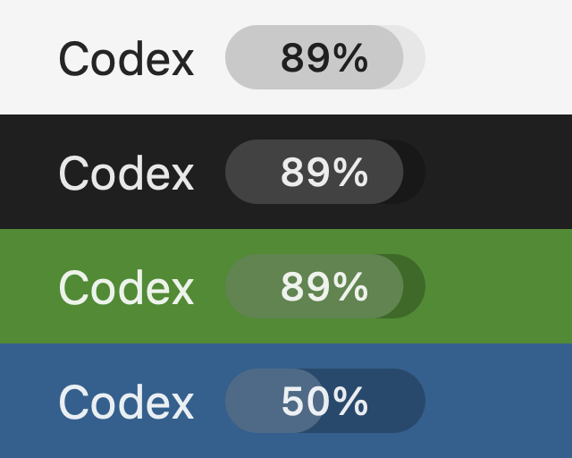

# Codex Usage Menu Bar

**抬眼看额度，专心写代码。**

一个轻量的原生 macOS 菜单栏工具：左侧显示 `Codex`，右侧用胶囊进度条显示剩余使用百分比。沿用本机 Codex 登录，不需要额外 API Key。

A lightweight native macOS menu bar app that shows your remaining Codex quota at a glance.

[](#环境要求)
[](https://www.swift.org/)
[](LICENSE)



*上图为组件渲染预览，百分比是示例数据。*

## 功能

- **一眼看剩余**：百分比居中显示在横向进度条内，填充量表示剩余额度。
- **原生外观**：系统菜单栏字体、语义文字颜色、柔和胶囊填充，适应深浅色外观和系统增强对比度设置。
- **自动更新**：每 60 秒读取一次，Mac 唤醒后刷新，也可以在菜单中选择“立即刷新”。
- **查看详情**：显示服务返回的额度窗口、已用比例、重置时间及上次成功更新时间。
- **登录后启动**：通过 macOS 系统登录项管理，可随时关闭；不显示 Dock 图标。
- **明确异常状态**：读取失败时保留上次结果并显示 `!`；数据超过 3 分钟未更新时标为过期。

## 环境要求

| 项目 | 要求 |
| --- | --- |
| 操作系统 | macOS 13 或更新版本 |
| 编译工具 | Xcode Command Line Tools，Swift 5.7 或更新版本 |
| Codex | 已安装并使用 ChatGPT 账号登录的 Codex 桌面应用或 Codex CLI |
| 网络 | 能访问 Codex 账号额度服务 |

当前已在 **macOS 27 / Apple Silicon** 上验证。构建脚本生成当前 Mac 架构的应用，Intel Mac 和较早系统仍需要实际验证。

仅使用 API Key 的登录方式可能无法返回 ChatGPT 订阅的额度窗口。

## 从源码安装

### 1. 准备编译工具和 Codex 登录

如果尚未安装 Xcode Command Line Tools：

```sh
xcode-select --install
```

确认已在 Codex 桌面应用中登录。使用 CLI 的用户也可以运行：

```sh
codex login
```

工具会依次检查 `/Applications`、`~/Applications` 中的 Codex 应用，以及 `~/.npm-global/bin`、`/opt/homebrew/bin`、`/usr/local/bin` 中的 Codex CLI。

### 2. 克隆、构建并安装

```sh
git clone https://github.com/ThierryCheng/codex-usage-menubar.git
cd codex-usage-menubar
zsh build.sh
zsh install.sh
```

应用安装到 `~/Applications/Codex Usage.app`，随后在菜单栏启动。首次启动会尝试注册登录项；若 macOS 要求允许，可通过工具菜单或“系统设置 → 通用 → 登录项与扩展”完成。

当前提供源码构建方式，应用在本机进行临时签名，未提供 Developer ID 签名或公证的安装包。

### 更新

先在工具菜单中选择“退出”，然后运行：

```sh
git pull --ff-only
zsh build.sh
zsh install.sh
```

## 百分比是什么意思？

显示的是**额度窗口内的剩余百分比**，不是 token 数，也不是余额或剩余可发送消息数。

```text
剩余百分比 = floor(clamp(100 - usedPercent, 0, 100))
```

- 优先使用服务返回的 `rateLimitsByLimitId`，并优先选择 `codex` 额度桶；旧版响应回退到 `rateLimits`。
- 菜单栏显示所选额度桶中第一个有效窗口，按 `primary`、`secondary` 的顺序选择。
- 点击菜单可以查看所有返回的额度桶和窗口。各窗口独立展示，**不会相加**。
- 额度窗口的时长与重置时间来自服务响应，不假定每个账号都有“5 小时 + 每周”两种限制。
- 缺失的百分比显示为 `—`，缺失的重置时间不显示；不会把缺失数据推断为 0% 或 100%。

服务可能存在更新延迟，因此这里展示的是最近一次成功读取的服务端结果。

## 工作方式与隐私

```text
菜单栏应用
  └─ 本机 Codex CLI / app-server（stdio）
       └─ account/rateLimits/read
            └─ 读取当前账号的额度窗口
```

本应用不直接解析或复制登录令牌，也不收集邮箱、账号 ID、聊天内容或提示词。登录状态与令牌刷新由本机 Codex 组件处理；本应用不发起模型生成请求。

应用会在以下位置写入本地显示状态，便于排查刷新和登录项问题：

```text
~/Library/Application Support/Codex Usage/status.json
```

该文件包含额度百分比、重置时间、更新时间和界面状态，不包含登录令牌。应用自身没有遥测上报或自建后端；Codex 子进程的认证和网络行为由 Codex 自身控制。

## 开发与验证

```sh
# 编译、临时签名，并运行数据解析检查
zsh build.sh

# 使用当前 Codex 登录实时读取额度；不会启动菜单栏或注册登录项
'build/Codex Usage.app/Contents/MacOS/CodexUsage' --check
```

现有检查覆盖：优先使用多额度桶响应、双窗口展示、未知值、空响应、旧版响应回退，以及额度桶之间的隔离。

```text
main.swift       原生菜单栏视图、菜单、刷新与登录项
Quota.swift      额度模型与 Codex app-server 读取
Tests.swift      额度解析检查
Info.plist       应用元数据
build.sh         本机编译、签名与检查
install.sh       安装到当前用户的 Applications 目录
docs/preview.png 界面渲染预览
```

## 常见问题

**菜单栏显示 `—` 或“额度接口读取失败”**

先确认 Codex 登录和网络正常，再运行上面的 `--check` 命令。如果使用 API Key 登录，请确认当前认证方式能返回 ChatGPT 订阅额度。

**提示未找到 Codex**

确认应用位于标准 Applications 目录，或者 CLI 位于前文列出的路径。使用版本管理器安装的 CLI 不一定出现在 GUI 应用的 `PATH` 中。

**菜单栏没有图标**

重新打开 `~/Applications/Codex Usage.app`。macOS 会在菜单栏空间不足时隐藏部分项目，也可以尝试减少其他菜单栏项目。

**修改源码后没有生效**

先退出运行中的版本，再重新构建和安装。同一时间只运行一个实例。

**Codex 更新后读取失败**

本项目使用 Codex 的 app-server 额度接口。Codex 更新可能改变接口或应用内 CLI 路径，欢迎提交包含版本信息和脱敏错误的 Issue。

## 卸载

1. 在工具菜单中取消“登录后自动启动”。
2. 选择“退出”。
3. 将 `~/Applications/Codex Usage.app` 移到废纸篓。
4. 如需清理诊断信息，可一并移除 `~/Library/Application Support/Codex Usage`。

## 贡献

欢迎通过 [Issues](https://github.com/ThierryCheng/codex-usage-menubar/issues) 报告问题，或提交 Pull Request。请附上 macOS、Codex 和 Swift 版本，以及复现步骤；不要上传登录令牌、`auth.json` 或账号的完整原始响应。

修改额度处理时请运行现有检查；修改菜单栏外观时请验证深浅色外观，以及 0%、50%、100% 和未知状态。

## 许可证与说明

采用 [MIT License](LICENSE)。这是独立开发的社区工具，与 OpenAI、Apple 没有隶属或背书关系。Codex、macOS 等名称属于各自权利人。

参考资料：[Codex App Server](https://learn.chatgpt.com/docs/app-server)、[Apple 菜单栏指引](https://developer.apple.com/design/human-interface-guidelines/the-menu-bar)、[Apple 材质指引](https://developer.apple.com/design/human-interface-guidelines/materials)、[SMAppService](https://developer.apple.com/documentation/servicemanagement/smappservice)。
